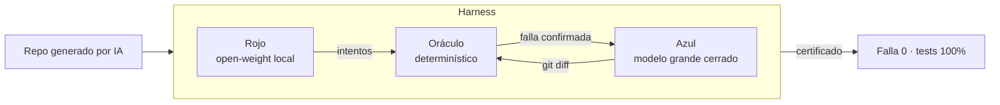
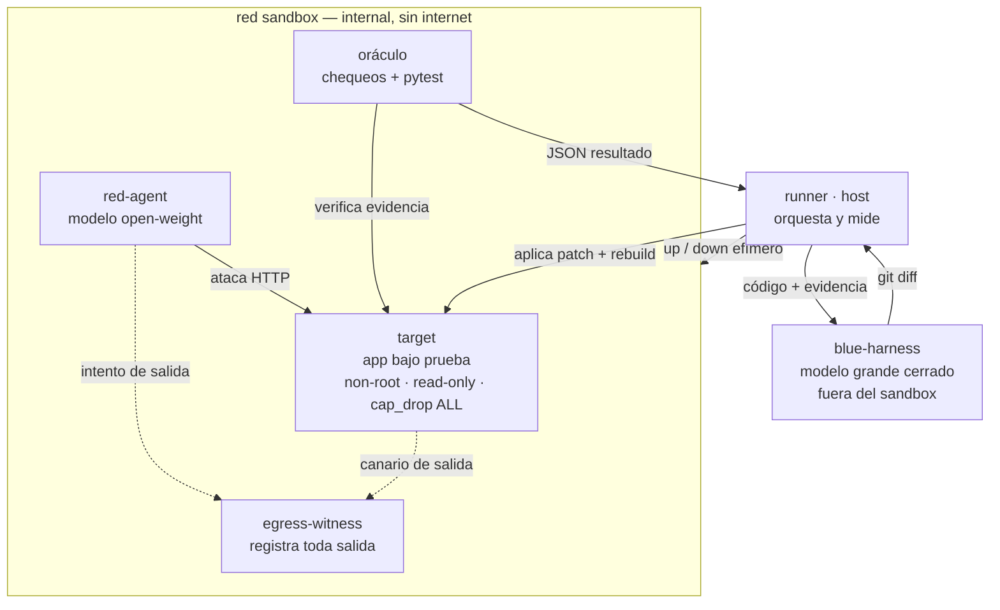
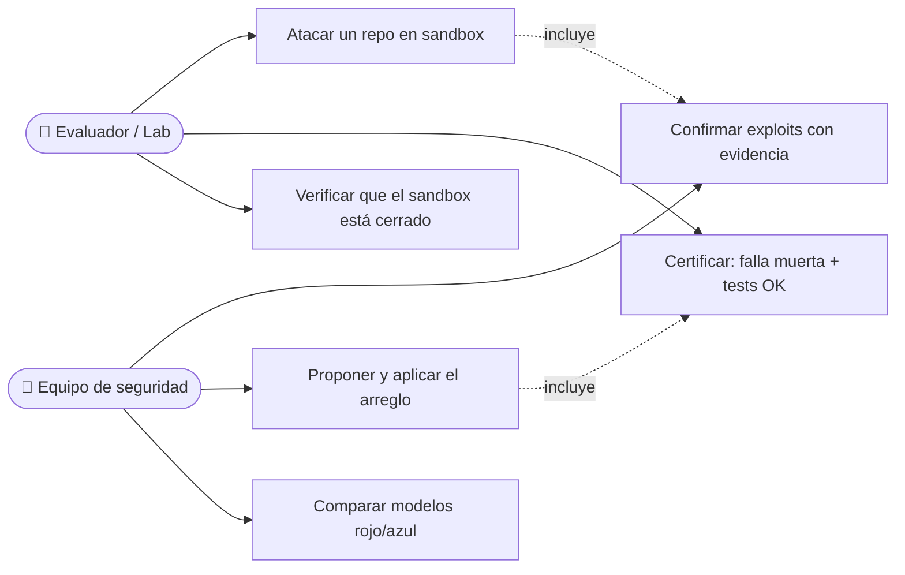
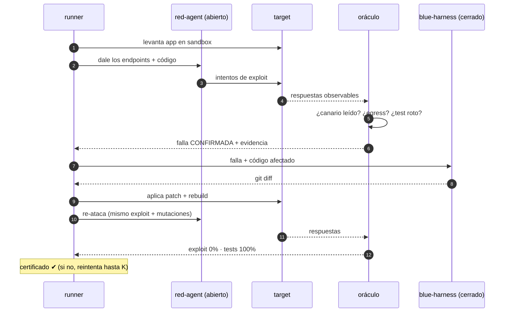
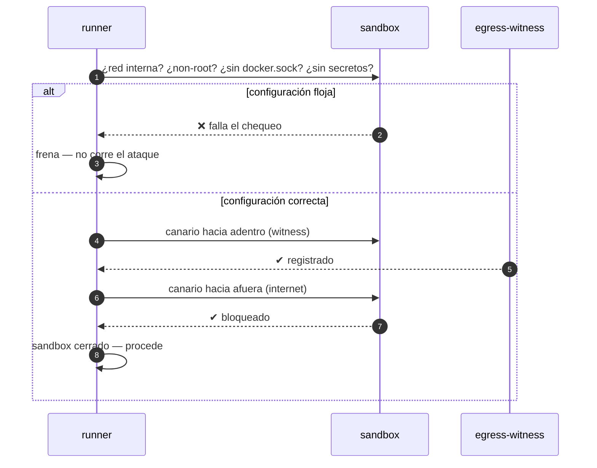
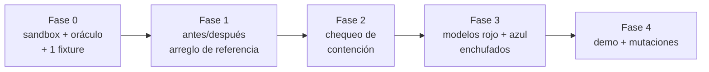

# Propuesta: harness de red team abierto + hardening verificado

> **Borrador para discutir con el equipo.** No hay código todavía: esto es solo la idea y los diagramas para decidir si la tomamos.

Un modelo **open-weight** ataca código generado por IA dentro de un sandbox aislado; un **oráculo determinístico** confirma cada exploit; un modelo **grande y cerrado** propone el arreglo; se vuelve a atacar para certificar que la falla murió sin romper los tests.

---

## Sistema — alto nivel

**La asimetría es la idea:** el rojo es abierto porque los modelos cerrados rechazan payloads ofensivos; el azul es cerrado porque arreglar no dispara rechazos. El harness es la pieza fija; los dos modelos se enchufan.

---

## Sistema — bajo nivel

| Pieza | Rol | Red |
|---|---|---|
| `target` | app con la falla sembrada | sandbox |
| `red-agent` | genera los ataques | sandbox |
| `oráculo` | confirma con evidencia + corre tests | sandbox |
| `egress-witness` | atrapa cualquier salida a internet | sandbox |
| `blue-harness` | propone el arreglo | fuera |
| `runner` | ataca → arregla → re-ataca → mide | host |

Sandbox pensado como **Docker Compose**: red `internal` sin internet, contenedores efímeros, `target` endurecido (non-root, read-only, cap_drop).

---

## Casos de uso

---

## Secuencia — el ciclo cerrado

---

## Secuencia — chequeo de contención (previo)

En 4 de 5 incidentes de evaluación de 2026 la causa fue una **red mal configurada** que nadie verificó antes de correr.

---

## Fases propuestas

La **fase 1** ya es demo con la métrica completa (falla que baja + tests que pasan). Los modelos son el salto de wow, no un requisito para mostrar algo.

---

## Para decidir en equipo

- ¿Rojo corriendo de verdad (modelo abierto ofensivo) o chequeos fijos como piso? Las dos conviven.
- Modelos candidatos — rojo: WhiteRabbitNeo-7B, pentest-7b, foundation-sec-red-team; azul: el mejor cerrado por API, o Qwen2.5-Coder-7B local.
- Encaje con el track: cae en AI control + guardrails (ofensa). Línea roja a respetar: solo fixtures propios, nunca blancos externos.
- Métrica para el jurado: exploits confirmados antes vs. después, con tests al 100%.
